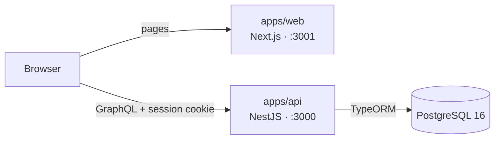

# Clensy

Clensy is an internal operations platform for cleaning and laundry businesses. Staff use a web console to manage customers and properties, cleaners and teams, the service catalog and pricing, bookings and cleaning jobs, laundry orders from intake to pickup, and invoices. It is multi-tenant: each business is a tenant, and every role sees only its own tenant's data.

## Architecture at a glance



*The web console runs in the browser and calls the GraphQL API directly. The API owns every business rule, role check and tenant boundary. More in the [architecture overview](docs/architecture/overview.md).*

## Tech stack

- **API:** NestJS 11, Apollo Server (code-first GraphQL), nestjs-query, TypeORM, PostgreSQL 16, Jest
- **Web:** Next.js 16 (App Router), React 19, Apollo Client, Tailwind CSS 4, next-intl, Vitest
- **Shared packages:** `@clensy/ui` (UI system), `@clensy/web` (domain components), `@clensy/client` (generated GraphQL hooks), `@clensy/validation`
- **Tooling:** pnpm workspaces, Turborepo, Docker Compose, GitHub Actions

## Prerequisites

- Docker with Compose v2
- Node.js 20 and pnpm 10.30.3 (run `corepack enable`; the version is pinned in `package.json`)

## Run locally

1. **Create the two environment files** from the example. The root `.env` configures Docker Compose; `apps/api/.env` configures the API.

   ```bash
   cp .env.example .env
   cp .env.example apps/api/.env
   ```

2. **Fill in `apps/api/.env`:**
   - `JWT_SECRET`: required, or the API will not start. Generate one with `openssl rand -base64 32`.
   - `ADMIN_SEED_EMAIL` and `ADMIN_SEED_PASSWORD`: choose a local login. The seed creates a Tenant Owner with these.

3. **Start Postgres, run migrations, then start the API and the web app.** Compose starts them in that order.

   ```bash
   docker compose up -d --build
   ```

4. **Seed data, including your login.**

   ```bash
   pnpm install
   pnpm db:seed
   ```

5. **Open http://localhost:3001** and sign in with the seed email and password.

After code changes, run `docker compose up -d --build` again: the stack runs built images, not watch mode.

## Verify it works

```bash
docker compose ps -a
```

`postgres` is healthy, `migrate` has exited with code 0, and `api` and `web` are running.

```bash
curl -s http://localhost:3000/graphql -H 'content-type: application/json' -d '{"query":"{ __typename }"}'
```

Expected output: `{"data":{"__typename":"Query"}}`.

| URL | What |
| --- | --- |
| http://localhost:3001 | Web console |
| http://localhost:3000/graphql | GraphQL API |
| http://localhost:3000/graphiql | GraphiQL IDE (development only) |
| http://localhost:3000/docs | REST API docs (development only) |

## Common issues

| Problem | Fix |
| --- | --- |
| `api` keeps restarting with `JWT_SECRET must be set` | Set `JWT_SECRET` in `apps/api/.env`, then `docker compose up -d --build`. |
| Postgres cannot bind port 5432 | Another Postgres is running. Change `DB_PORT` in both `.env` files. |
| Login fails | Set `ADMIN_SEED_EMAIL`/`ADMIN_SEED_PASSWORD` in `apps/api/.env` and run `pnpm db:seed`. |
| `api` and `web` never start | A migration failed: `docker compose logs migrate`. |

More in [troubleshooting](docs/getting-started/local-development.md#troubleshooting).

## Documentation

- [Documentation home](docs/README.md): every guide, grouped by task
- [Local development](docs/getting-started/local-development.md): environment files, seed data, debugging
- [Architecture overview](docs/architecture/overview.md) and [authentication and tenancy](docs/architecture/auth-and-tenancy.md)
- [Testing and CI](docs/development/testing-and-ci.md) and [database migrations](docs/development/database-migrations.md)
- [Laundry orders](docs/features/laundry.md) and the [design records](docs/superpowers/README.md) (specs and plans)
- [Contributing](CONTRIBUTING.md): workflow, branches, pull requests, where docs go
