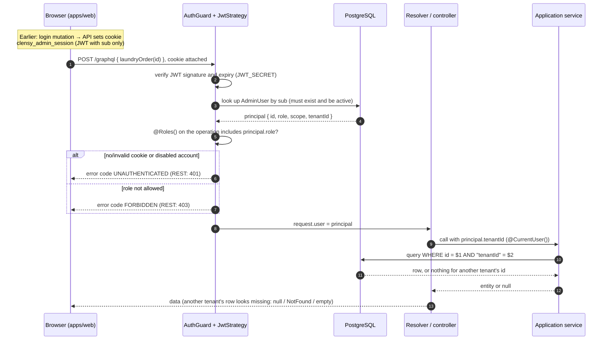

# Authentication, authorization and tenant isolation

How the API decides who is calling, what they may do, and which tenant's data they see. This page describes the current implementation. The binding contract is the Accepted [multi-tenant architecture spec](../superpowers/specs/2026-09-23-multi-tenant-architecture-design.md); the per-role permissions are pinned in code, in [`apps/api/test/release-gate/role-matrix.ts`](../../apps/api/test/release-gate/role-matrix.ts). How each entity became tenant-owned is recorded in [shipped slices](../history/shipped-slices.md).

## Concepts

| Term | Meaning |
| --- | --- |
| **Tenant** | One business using Clensy. A migration creates one bootstrap tenant; the seed never creates tenants. |
| **Principal** | The authenticated caller: `{ id, role, scope, tenantId }` (`AuthenticatedPrincipal`). Always re-read from the database, never taken from the token. |
| **Scope** | `PLATFORM` (Super Admin, `tenantId` null) or `TENANT` (every other role, `tenantId` set). A database `CHECK` keeps role, scope and tenant consistent. |
| **Role** | `SUPER_ADMIN`, or one of six tenant roles: `TENANT_OWNER`, `OPS_MANAGER`, `SCHEDULER`, `CUSTOMER_SUPPORT`, `FINANCE`, `ANALYST`. |
| **Tenant-owned row** | A row with a required `tenantId`. Every business table is tenant-owned, directly or through its parent (checklist items through their checklist, invoice lines through their invoice). |

## Request lifecycle

*A representative read. Writes follow the same path and also write an audit event in the same transaction as the change.*

## Authentication

- **Login.** The `login` mutation checks the email and password (bcrypt) and issues a JWT whose only claim is `sub` (the admin id). The API sets it as the `clensy_admin_session` cookie: `HttpOnly`, `Secure`, `SameSite=Lax`, `Max-Age` from `JWT_EXPIRES_IN` (default `8h`). `logout` clears it.
- **Every request.** `AuthGuard` (Passport `jwt` strategy) reads the cookie, never an `Authorization` header, verifies it, and re-loads the admin. A disabled or deleted account is rejected on its next request even though its token has not expired. A login whose stored scope and tenant disagree is refused.
- **Secret.** `JWT_SECRET` is required; `TokenService` and `JwtStrategy` refuse to start without it, except in tests.
- **Web app.** The browser holds no token: the cookie is HttpOnly, and Apollo Client sends it with `credentials: 'include'`. The API allows exactly one CORS origin, `WEB_ORIGIN`. `apps/web/middleware.ts` redirects `/app/*` to `/login` when the cookie is absent, and the web `SessionGuard` sends the user to `/login` when the API answers `UNAUTHENTICATED`. These are UX only.

## Authorization

- **The root operation is the unit of authorization.** Each GraphQL root query/mutation and each REST route declares `@UseGuards(AuthGuard)` and `@Roles(...)`. A relation field (for example `invoice { customer }`) is authorized by the root operation that reaches it, not by the target type's own roles; relation fields declare no guards or roles of their own. Adding a relation is therefore an authorization-policy change (#106).
- **Super Admin is on no tenant operation.** A platform principal cannot read or write tenant business data.
- **The web app's role gating is not security.** Nav visibility (`viewRoles` in `apps/web/lib/nav-groups.ts`), the page gate and the landing page decide what is *shown*; the API decides what is *allowed*.

## Tenant isolation

Isolation is enforced in three layers, so a gap in one is caught by another:

| Layer | Mechanism |
| --- | --- |
| Services | Every read and write passes the principal's `tenantId` and filters by it (`{ id, tenantId }`). `requireTenantId(principal)` rejects a platform principal. |
| GraphQL reads | nestjs-query read resolvers, relations and object fields use `tenantReadAuthorizer()`, which adds `tenantId = <caller's tenant>` (or matches nothing for a platform principal). GraphQL runs interceptors on field resolvers so relation filters always apply. |
| Database | Tenant-owned tables reference their parents through composite foreign keys `(refId, "tenantId") → parent(id, "tenantId")`, so a row can never point at another tenant's row. Uniqueness (customer email, service name, invoice number, …) is per tenant. |

**Cross-tenant looks missing.** Another tenant's id behaves exactly like an id that never existed: `null`, the usual NotFound error, or an empty list. The API never answers 403 for it, so a caller cannot probe which ids exist elsewhere.

## Audit

Every business mutation writes an `AuditEvent` through `AuditLogger`, in the same transaction as the change. Each event's scope matches its principal: tenant events carry the tenant id, platform events carry none, and the only anonymous event is a failed login. Events recorded before #90 have no scope or tenant; they were not backfilled.

## How this is enforced in tests

| Suite (`apps/api/test/`) | Checks |
| --- | --- |
| `two-tenant-release-gate.e2e-spec.ts` | Against two live tenants: every operation and route is inventoried, the role matrix equals the live `@Roles()`, and authentication, authorization, isolation, integrity and symmetry all hold. See [testing and CI](../development/testing-and-ci.md#two-tenant-release-gate). |
| `root-operation-authorization.e2e-spec.ts` | Every root query and mutation is classified public, authenticated-only, or tenant with roles excluding Super Admin. |
| `tenant-read-authorizers.e2e-spec.ts` | Every nestjs-query read surface and tenant-owned entity is tenant-scoped or explicitly allowlisted with a reason. |
| `http-route-authorization.e2e-spec.ts` | Every controller route is classified, guarded, and returns 401 without a session. |
| `relation-field-authorization.e2e-spec.ts` | Relation fields carry no guards or roles of their own. |

**When you add an operation, route, relation or tenant-owned entity**, these suites fail until you classify it. Update `role-matrix.ts` only when an Accepted authorization spec changes.
