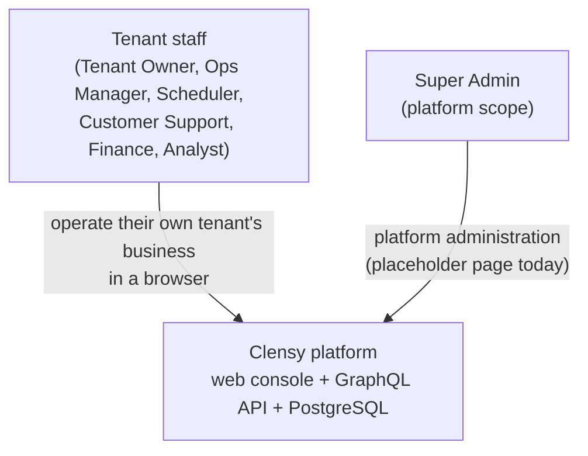
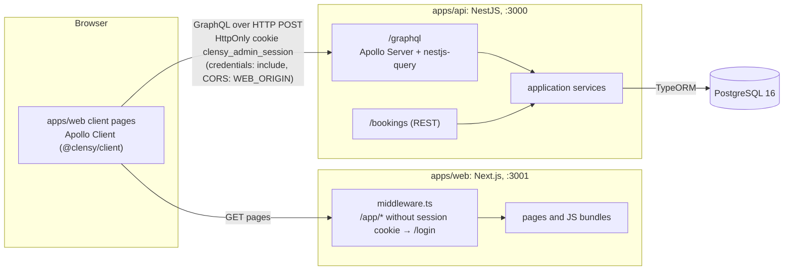
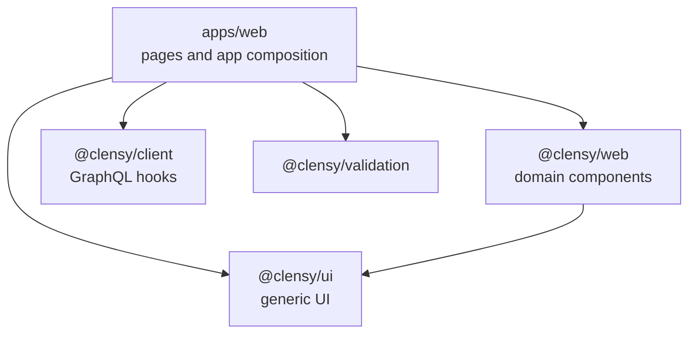

# Architecture overview

Clensy is a multi-tenant operations console for cleaning and laundry businesses. This page shows who uses it, which parts it is made of, how they communicate, and where each responsibility lives in the repository. Security details (sessions, roles, tenant isolation) are in [authentication and tenancy](auth-and-tenancy.md).

## System context



*Who uses Clensy. Every user is an internal staff account (`AdminUser`); there is no customer-facing portal. Clensy has no external integrations today: no email, payment, messaging, queue or cache service.*

Each tenant is one business. Tenant staff see and change only their own tenant's data. A Super Admin has platform scope and no access to any tenant's business data.

## Containers and communication



*How the parts talk. Data never passes through the Next.js server: every page under `/app` is a client component, and the browser calls the API directly. The Next.js middleware only checks that a session cookie exists; the API is the authorization boundary.*

| Part | Technology | Responsibility |
| --- | --- | --- |
| `apps/web` | Next.js 16 (App Router), React 19, Tailwind CSS 4, next-intl | Pages, navigation, forms, client-side UX gating (which nav items and pages a role sees). |
| `apps/api` | NestJS 11, Apollo Server 5, nestjs-query, TypeORM | Business rules, authentication, role checks, tenant scoping, audit log, schema migrations. |
| PostgreSQL | 16 | All state. Schema is managed only by migrations (`synchronize: false`). |
| `@clensy/client` | Apollo Client 3 + graphql-codegen | Typed hooks generated from `apps/api/src/schema.gql`. |
| `@clensy/ui` | shadcn/Radix internally | Generic UI primitives and composition. The only UI entry point for apps. |
| `@clensy/web` | React | Reusable Clensy domain components (login form, data tables, laundry pickers) with their own translations. |
| `@clensy/validation` | — | Rule-string validation, React Hook Form resolver, GraphQL error normalizer. |

## Frontend package boundaries



*Allowed dependency directions. `@clensy/web` must not fetch data (no `@clensy/client`/Apollo) and must not import `next-intl`; `@clensy/ui` must not import an application or hold Clensy copy. Apps never import shadcn or Radix directly. The rules and their guard tests are in each package README: [`@clensy/ui`](../../packages/ui/README.md), [`@clensy/web`](../../packages/web/README.md), [`apps/web`](../../apps/web/README.md#ui).*

## Backend structure

The API is split into **platform** infrastructure (`auth`, `audit`, `config`, `database`, `graphql`, `openapi`) and **business modules**:

| Module | Owns |
| --- | --- |
| `admins` | Staff accounts, login/logout, the current principal |
| `customers` | Customers and their properties |
| `cleaners` | Cleaners and teams |
| `catalog` | Services, add-ons, effective-dated pricing rules |
| `bookings` | Bookings (GraphQL and REST) |
| `jobs` | Cleaning jobs and checklists |
| `laundry` | Laundry orders, their lifecycle, weighing, price preview and pricing |
| `billing` | Invoices generated from laundry orders |

Each module is layered domain → application → infrastructure → presentation. The layering, the source tree and the HTTP surface are in the [`apps/api` README](../../apps/api/README.md).

## Repository map

```text
apps/api/            NestJS API, migrations, seed, e2e tests
apps/web/            Next.js web console
packages/client/     generated GraphQL client
packages/ui/         generic UI system
packages/web/        Clensy domain components
packages/validation/ form validation
packages/{auth,config,domain,graphql,testing}/
                     empty stubs, deliberately: extract only when a second consumer needs it
docs/                documentation (start at docs/README.md)
docker-compose.yml   local stack: postgres, migrate, api, web
.github/workflows/   CI
```

## Design records

The decisions behind this architecture are in the Accepted specs, indexed in [design records](../superpowers/README.md). The most important ones:

- [Phase 1 design](../superpowers/specs/2026-08-14-clensy-platform-phase1-design.md): product scope, monorepo layout, module layering.
- [Multi-tenant architecture](../superpowers/specs/2026-09-23-multi-tenant-architecture-design.md): tenants, scopes, roles, isolation.
- [Web shell and design system](../superpowers/specs/2026-09-10-web-shell-and-design-system-design.md) and [shadcn/ui boundary](../superpowers/specs/2026-09-16-shadcn-ui-boundary-design.md): frontend structure.
