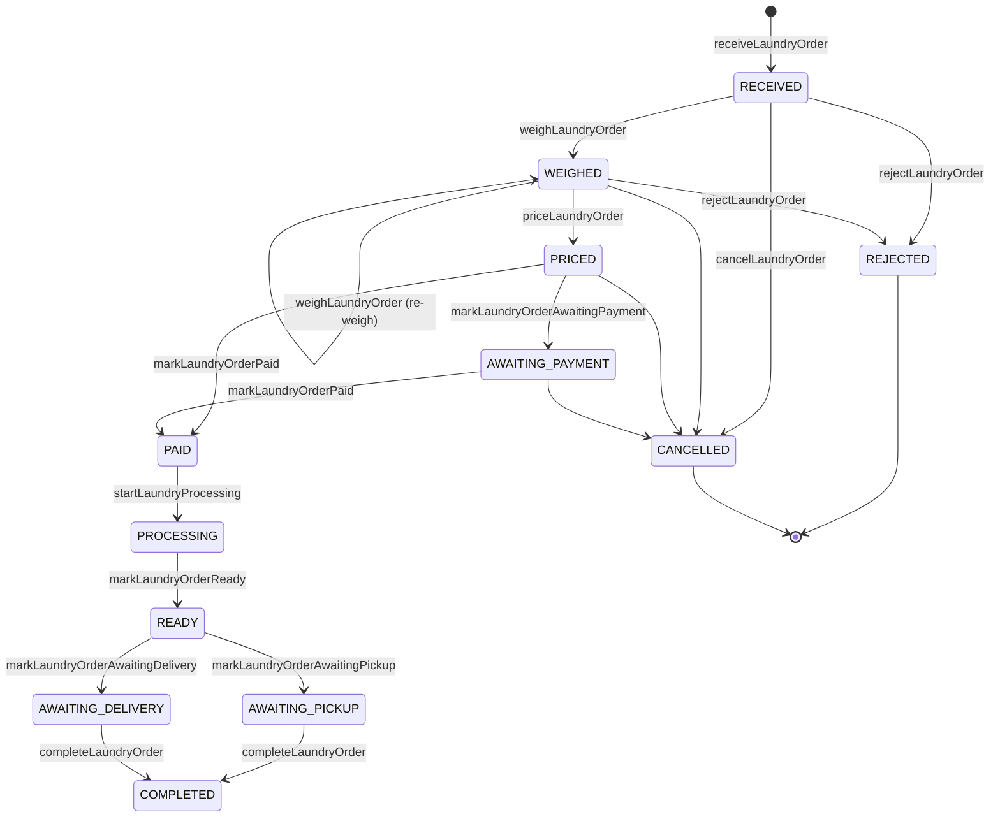
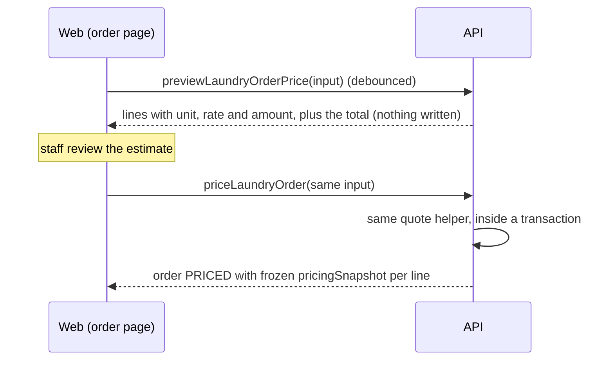

# Laundry orders

A laundry order is received, weighed, priced from the catalog, paid, processed and handed back. This page covers the lifecycle and the API rules that are easy to get wrong. The binding contract is the Accepted [laundry orders lifecycle spec](../superpowers/specs/2026-09-06-laundry-orders-lifecycle-design.md), including Amendment #164 (§8.4); pricing comes from the [laundry catalog foundation spec](../superpowers/specs/2026-09-06-laundry-catalog-foundation-design.md) and invoices from the [laundry invoices spec](../superpowers/specs/2026-09-06-laundry-invoices-design.md).

The web screens (list, intake dialog, order page with weighing, services and price review) are documented in [`apps/web/README.md`](../../apps/web/README.md#laundry-list-applaundry).

## Lifecycle

*The happy path and the early exits. The full matrix is `LaundryOrderStatusTransitionPolicy` in `apps/api/src/modules/laundry/domain/laundry-order-status-transition-policy.ts`; any other transition is rejected with `Laundry order cannot transition from X to Y`.*

Not drawn, to keep the diagram readable:

| From | Also allowed |
| --- | --- |
| `PROCESSING`, `READY`, `AWAITING_PICKUP`, `AWAITING_DELIVERY` | `LOST` (`markLaundryOrderLost`), `DAMAGED` (`markLaundryOrderDamaged`) |
| `PAID`, `PROCESSING`, `READY`, `AWAITING_PICKUP`, `AWAITING_DELIVERY`, `COMPLETED`, `LOST`, `DAMAGED` | `REFUNDED` (`refundLaundryOrder`) |

`CANCELLED`, `REJECTED` and `REFUNDED` are final.

Which roles may call each mutation is pinned in [`role-matrix.ts`](../../apps/api/test/release-gate/role-matrix.ts). Invoices are generated from an order with `generateInvoiceFromOrder` (module `billing`).

## Weighing

- `weighLaundryOrder` accepts `RECEIVED` and `WEIGHED` orders (re-weighing is allowed until the order is priced).
- `weightGrams` must be a positive integer: `@IsInt() @Min(1)` on the input, and `LaundryOrdersService.weigh` throws `BadRequestException('weightGrams must be a positive integer')` before opening a transaction (#155).
- The database `CHECK` `ck_laundry_order_weight_non_negative` still allows `0`, and orders already stored with `0` grams were not rewritten.

## Price preview and pricing

*The estimate and the confirmation run the same calculation; only pricing writes.*

- **Preview** (`previewLaundryOrderPrice`, #159) is read-only, for `TENANT_OWNER`, `OPS_MANAGER` and `SCHEDULER` (the same roles as pricing). It runs the same checks, quantity rules, amount function and error order as `priceLaundryOrder`; both go through one private `quote` helper. It works only on a `WEIGHED` order with a recorded weight, and writes nothing: no transaction, lock, line, status, total or audit event. Each line shows the **current** catalog name. A repeated add-on is quoted as its own line, as pricing treats it.
- **Pricing** (`priceLaundryOrder`) writes the lines, the total and a frozen `pricingSnapshot` per line, including `description`: `Service.name` for the base line, `AddOn.name + " (add-on)"` for an add-on line (the same string invoice lines use). Renaming the service or add-on later does not change it. If a name cannot be read in the caller's tenant, pricing fails with 400 and writes nothing.
- **The snapshot is authoritative** for what was charged. `pricingSnapshotPricingRuleId` is a soft pointer with no FK.
- Lines priced before migration `1790956800000-AddLaundryLineDescription` carry the name as it was when the migration ran, not when they were priced. See [database migrations](../development/database-migrations.md#1790956800000-addlaundrylinedescription).
- **Guards.** The preview query is classified in the root-operation inventory, the release-gate role matrix and probes, the tenant-read authorizer sweep, and the laundry/billing schema guard. The release-gate outcome classifier has one rule limited to `previewLaundryOrderPrice`: it reads each line's single `serviceId`/`addOnId` target and never treats the money total as a count.

## Tenancy

Laundry orders, their lines and invoices are tenant-owned (#87). Lines reference services and add-ons through composite tenant FKs, so a tenant cannot price another tenant's order. Invoice numbers are allocated per tenant. See [authentication and tenancy](../architecture/auth-and-tenancy.md).

## History

The delivery slices are listed in [shipped slices](../history/shipped-slices.md#laundry-price-preview--frozen-line-description-159) and their plans in [design records](../superpowers/README.md).
