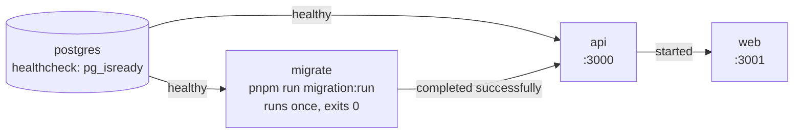

# Local development

The full local setup: what each environment file is for, how the Docker Compose stack starts, how to get data to log in with, and what to check when something goes wrong. The short version is in the [root README](../../README.md#run-locally).

## Prerequisites

| Tool | Version | Why |
| --- | --- | --- |
| Docker with Compose v2 | any current | Runs Postgres, the migration job, the API and the web app. The stack uses `depends_on` health and completion conditions, which need Compose v2. |
| Node.js | 20 | Host-side commands: seeding, tests, generating migrations. CI and both Dockerfiles use Node 20. |
| pnpm | 10.30.3 | Pinned by `packageManager` in `package.json`. `corepack enable` installs the pinned version. |

## Environment files

Two files, both gitignored, both created from [`.env.example`](../../.env.example), which documents every variable.

| File | Read by | Must contain |
| --- | --- | --- |
| `.env` (root) | `docker compose`, for `${…}` substitution in `docker-compose.yml` | `DB_USERNAME`, `DB_PASSWORD`, `DB_NAME`, `DB_PORT`. Optional: `APP_DEBUG`, `WEB_ORIGIN`, `NODE_ENV`. |
| `apps/api/.env` | The API (Nest `ConfigModule`), the TypeORM CLI and both seed scripts; e2e reads its connection values but never `DB_NAME` | `JWT_SECRET` (required; the API refuses to start without it), `JWT_EXPIRES_IN`, the same `DB_*` values. Optional: `ADMIN_SEED_EMAIL`, `ADMIN_SEED_PASSWORD`. |

How `apps/api/.env` reaches the container: `.dockerignore` excludes only the root `.env`, so `apps/api/.env` is copied into the API image at build time. `docker-compose.yml` then overrides `DB_HOST`/`DB_PORT` with the container-network address (`postgres:5432`), and environment variables win over the file. **Rebuild the image (`--build`) after changing `apps/api/.env`.**

On the host, `DB_HOST=localhost` and `DB_PORT` (the host-mapped port) in `apps/api/.env` are what `pnpm db:seed` and the migration commands use.

`apps/web` needs no file for local use: `NEXT_PUBLIC_API_URL` defaults to `http://localhost:3000/graphql` (see [`apps/web/.env.example`](../../apps/web/.env.example)). That URL is reached by the browser, so it is the host-mapped port, not the container network.

Never commit either `.env` file, and never put real credentials in `.env.example`.

## Start the stack

```bash
docker compose up -d --build
```



*Startup order enforced by `docker-compose.yml`. The API starts only after every pending migration has applied; if `migrate` fails, `api` and `web` never start.*

| Service | Image | Host port | Notes |
| --- | --- | --- | --- |
| `postgres` | `postgres:16-alpine` | `${DB_PORT}` | Data in the `clensy_postgres_data` volume. |
| `migrate` | `Dockerfile` | — | Applies pending migrations, then exits. |
| `api` | `Dockerfile` | 3000 | Runs as `NODE_ENV=development` unless `.env` sets `NODE_ENV=production`. |
| `web` | `Dockerfile.web` | 3001 | Production Next.js build (`next start`). |

**Ports.** 3000 and 3001 are fixed in `docker-compose.yml`, and the rest of the setup assumes them: the web app calls `http://localhost:3000/graphql` by default and the API allows CORS from `http://localhost:3001` by default. Only the Postgres host port is configurable (`DB_PORT`). If another process or Compose stack holds 3000 or 3001, `docker compose up` fails with `port is already allocated` or `address already in use`; stop that process first. Two checkouts of this repository cannot run their stacks at the same time.

The stack runs **built images**, not watch mode. After changing code, run `docker compose up -d --build` again.

## Seed data

A fresh database has the schema and one bootstrap tenant (created by a migration), but no admin account, so nobody can log in until you seed. Seeding is a separate, explicit step; it never runs on boot.

```bash
corepack enable
pnpm install
pnpm db:seed
```

`pnpm db:seed` is idempotent: every row has a fixed key and is upserted, so running it again never duplicates data. It:

1. Upserts one fixture Customer, Property, Service and Team, then three bookings that reference them.
2. If `ADMIN_SEED_EMAIL` and `ADMIN_SEED_PASSWORD` are both set in `apps/api/.env`, upserts a `TENANT_OWNER` admin of the bootstrap tenant with those credentials. If either is unset it prints `Skipping dev Owner seed` and carries on.

**Re-running resets the seed's own rows.** The fixture customer, property, service, team and bookings are overwritten with their seed values (by id), so edits made to them are lost. The admin is upserted by email, and that upsert rewrites the whole account: it moves it into the Bootstrap tenant, re-scopes it to `TENANT`, re-roles it to `TENANT_OWNER`, re-enables it and re-hashes its password from `ADMIN_SEED_PASSWORD`. It does this even to an account that `pnpm db:seed:dev-owner` refused as mismatched, so **`pnpm db:seed` is not a safe way to check the development owner**. No other row is touched.

`pnpm install` may warn about "Ignored build scripts" (bcrypt, esbuild and others). The seed and the commands in this guide work without approving them.

The bookings have the fixed ids `00000000-…-0001` to `…0003`. The seed creates no tenant and no other roles. Create further data through the web console, or through GraphQL once logged in (`createCustomer`/`createProperty`, `createCleaner`/`createTeam`, `createService`/`createAddOn`/`createPricingRule`, `createJobFromBooking`, `receiveLaundryOrder`). Seed sources: `apps/api/src/platform/database/seed.ts` (entrypoint) and `apps/api/src/modules/bookings/infrastructure/persistence/seed/`.

### The development owner (`pnpm db:seed:dev-owner`)

`pnpm db:seed:dev-owner` creates or verifies exactly one persistent Bootstrap-tenant `TENANT_OWNER` from `ADMIN_SEED_EMAIL` and `ADMIN_SEED_PASSWORD`, and changes nothing else. Run it from the repository root; it reads `apps/api/.env`, and values set in the shell win.

```bash
pnpm db:seed:dev-owner                      # first run creates the owner; later runs verify it
pnpm db:seed:dev-owner --reset-password     # also sets the password to ADMIN_SEED_PASSWORD
```

- **First run:** creates the owner. Output: `created`.
- **Re-runs:** change nothing, and report whether `ADMIN_SEED_PASSWORD` still matches: `password: matches ADMIN_SEED_PASSWORD`, or `password: differs from ADMIN_SEED_PASSWORD (run with --reset-password to apply it)`.
- **`--reset-password`:** changes only the password hash of a correctly configured owner. Write it exactly as above: `pnpm db:seed:dev-owner -- --reset-password` passes a literal `--` and is refused, which fails closed.
- **Output:** one line with the outcome, the admin id, the database and host, and where each `ADMIN_SEED_*` value came from (`launch environment` or `apps/api/.env`). It never prints the email, the password or the hash. The source is labelled `apps/api/.env` because the supported invocations run in `apps/api`; run directly from another directory, the label still says `apps/api/.env` while the file read is `.env` in that directory.
- **It refuses, before connecting,** when `NODE_ENV` is `production`, either `ADMIN_SEED_*` value is missing, the connection settings are invalid, the host is not `localhost`, `127.0.0.1` or `postgres`, or the database is a Test database (a name ending in `_test`). After connecting, it refuses if the Bootstrap tenant is missing. A refusal writes nothing.

Failures, which write nothing and exit non-zero:

| Output | Meaning | Resolve by hand |
| --- | --- | --- |
| `mismatch id=<id> role differs` (and/or `scope`, `tenantId`, `isActive`) | An account with that email exists but is not the Bootstrap `TENANT_OWNER`, or is disabled. | Fix that account in the web console or with SQL (role `TENANT_OWNER`, scope `TENANT`, tenant = the Bootstrap tenant, `isActive` true), or choose a different `ADMIN_SEED_EMAIL`. The command never repairs, moves, escalates or re-enables an account. |
| `existing account email is not normalised count=1` | The stored email differs in case from the lowercased `ADMIN_SEED_EMAIL`. | Update that row's `email` to lowercase, then re-run. |
| `ambiguous: <N> accounts match` | Several accounts match the email case-insensitively. | Remove or rename the duplicates until one lowercase row remains, then re-run. |

## Development and e2e databases

The Compose `postgres` server holds two databases: **`clensy`**, the development database that Compose, the API, the migrations and both seeders use, and **`clensy_test`**, which the API e2e suites use. The e2e run creates and migrates `clensy_test` on its first run, so no setup step is needed. `docker compose down -v` deletes both; the next e2e run recreates `clensy_test`, and `docker compose up` (the `migrate` service) plus the seeders recreate `clensy`.

**Do not export `DB_NAME` in your shell.** e2e takes its database name only from the launch environment, never from a file, and fails with an error if that name does not end in `_test`. Compose and the host tools would follow an exported `DB_NAME=clensy_test` into the test database, where e2e then deletes their data. To see what Compose will use: `docker compose config | grep DB_NAME`.

| Actor | Where | Database name from | Host:port | Database |
| --- | --- | --- | --- | --- |
| `postgres` | container | root `.env` → `POSTGRES_DB` (first init only) | — | creates `clensy` |
| `migrate`, `api` | container | Compose `environment:` ← root `.env` / shell | `postgres:5432` | `clensy` |
| `web` | container | — (talks to the API over HTTP at `localhost:3000`) | — | — |
| `db:seed`, `migration:run`, `db:seed:dev-owner` | host | `apps/api/.env`, unless the shell sets it | `localhost:${DB_PORT}` | `clensy` |
| `pnpm --filter api test:e2e` | host | launch environment, or the `clensy_test` default; never a file | `localhost:${DB_PORT}` | `clensy_test` |

**Two checkouts running e2e at the same time** against one server share `clensy_test`. Each run migrates it with its own branch's migrations, so one branch can silently leave the other's schema ahead or diverged. They never connect to `clensy`. This is out of scope for the e2e setup; to isolate them, give each command its own Test-database name, per command and never exported: `DB_NAME=<branch>_test pnpm --filter api test:e2e`.

**Resetting a stale or diverged `clensy_test`** (for example after switching to a branch with fewer or different migrations). The e2e run's pending-migration check catches a schema that is behind the code, but not one that is ahead or diverged. Drop the database, and the next e2e run recreates it:

```bash
dropdb -h localhost -p <DB_PORT from apps/api/.env> -U <DB_USERNAME> clensy_test
# or, through Compose:
docker compose exec postgres sh -c 'dropdb -U "$POSTGRES_USER" clensy_test'
```

Run it only when no e2e run is active. **Check the name before you press Enter: the same command with `clensy` deletes the development database.**

**Leftover scratch databases.** The migration suites create and drop databases named `clensy_migration_<32 hex>_test`. A crashed run can leave one behind. List them with `docker compose exec postgres sh -c 'psql -U "$POSTGRES_USER" -d clensy -c "SELECT datname FROM pg_database WHERE datname LIKE '"'"'clensy\_migration\_%\_test'"'"'"'`, and drop only names of exactly that form, only when no e2e run is active.

### Residual risks

What the e2e isolation does not guarantee:

- **Host names are checked by name only.** `postgres` resolves through `/etc/hosts` or DNS, and `localhost`/`127.0.0.1` can forward through an SSH tunnel, `kubectl port-forward` or a Docker port mapping to a remote server.
- **What still protects e2e is connection confinement only:** every e2e connection is to a database whose name ends in `_test`, so e2e data changes, cleanup and lock waits stay in that database.
- **The seeder through a tunnel:** a tunnel to a remote server's `clensy` would pass every seeder guard, and the seeder would create or verify an owner there (a password change still needs `--reset-password`).
- **Cross-database statements.** Under Compose and CI, e2e connects as the role that created the server, which the official `postgres` image documents as a superuser; this has not been observed on this project's servers. A session confined to a Test database could still drop, rename or otherwise alter another database, use `dblink` or `postgres_fdw` if installed, or make server-wide changes. These are examples, not a complete list. The e2e static checks forbid the obvious forms in committed test code; they are hygiene, not a security boundary.
- **Session termination.** The same role could call `pg_terminate_backend()` or `pg_cancel_backend()` on the Compose API's sessions. That changes no data but can interrupt them. e2e code is forbidden to call them, checked by a static scan that is not a security boundary.
- **Concurrent runs** from two checkouts: by design they operate only on their Test databases; that is intended behaviour, not a guarantee. See above.
- **Checkouts without the e2e isolation.** Any checkout or worktree that predates it still runs e2e against `clensy`, and its tests truncate `admin_user_entity`, which deletes the development owner. **Before seeding the development owner, inspect every existing checkout and worktree** (`git worktree list`), and rebase or retire each one that lacks the isolation, or do not run e2e in it.

## Local URLs

| URL | What |
| --- | --- |
| http://localhost:3001/login | Web console sign-in (public) |
| http://localhost:3001/app | Web console, signed in. Tenant users land on their first visible nav item: Bookings, Jobs, Laundry, Billing, Customers, Cleaners, Teams, Catalog, Add-ons, Admin (Tenant Owner only). A Super Admin lands on `/app/platform`. |
| http://localhost:3000/graphql | GraphQL API (POST only; a browser visit returns 400) |
| http://localhost:3000/graphiql | GraphiQL IDE (dev only) |
| http://localhost:3000/bookings | REST bookings (requires the session cookie) |
| http://localhost:3000/docs | Swagger UI for REST (dev only) |

Which page each role sees is described in [`apps/web/README.md`](../../apps/web/README.md).

## Checking it works

```bash
docker compose ps -a
```

Expected: `postgres` running (healthy), `migrate` exited (0), `api` and `web` running.

```bash
curl -s http://localhost:3000/graphql \
  -H 'content-type: application/json' \
  -d '{"query":"{ __typename }"}'
```

Expected: `{"data":{"__typename":"Query"}}`.

Then open http://localhost:3001/login and sign in with the `ADMIN_SEED_*` credentials from `apps/api/.env`.

## Debugging

- **Logs:** `docker compose logs -f api` (or `web`, `migrate`).
- **SQL logging:** set `APP_DEBUG=true` in the root `.env`, then recreate the container with `docker compose up -d api`. Only the exact string `true` enables it.
- **Database shell:** `docker compose exec postgres psql -U <DB_USERNAME> -d <DB_NAME>`.
- **GraphQL by hand:** GraphiQL at `/graphiql`. Log in with the `login` mutation first; the session is an HttpOnly cookie (`clensy_admin_session`) the browser then sends automatically.

## Troubleshooting

| Symptom | Cause | Fix |
| --- | --- | --- |
| `api` keeps restarting; logs say `JWT_SECRET must be set` | `apps/api/.env` missing, or `JWT_SECRET` empty, when the image was built | Set `JWT_SECRET` in `apps/api/.env` (for example `openssl rand -base64 32`), then `docker compose up -d --build`. |
| `docker compose up` fails with `port is already allocated` / `address already in use` on 3000 or 3001 | Another process or Compose stack holds the port (for example a second checkout's stack) | Stop it: `docker ps`, `lsof -i :3000`. These ports are fixed; see [ports](#start-the-stack). |
| `postgres` fails to bind its port | Something else already uses `DB_PORT` (often a local Postgres on 5432) | Change `DB_PORT` in both `.env` and `apps/api/.env`. |
| `api` and `web` never start; `migrate` exited non-zero | A migration refused to run against existing data | `docker compose logs migrate`; the migration's own pre-check message names the rows. See [database migrations](../development/database-migrations.md). |
| Login fails on a fresh database | No admin exists yet | Set `ADMIN_SEED_EMAIL`/`ADMIN_SEED_PASSWORD` in `apps/api/.env` and run `pnpm db:seed`. |
| `pnpm db:seed` cannot connect | Host-side values in `apps/api/.env` do not match the stack | `DB_HOST=localhost`, `DB_PORT` = the host-mapped port, same credentials as the root `.env`. |
| `pnpm --filter api test:e2e` fails at once with `e2e DB_NAME "…" is not a Test database` | `DB_NAME` is set in the shell to a name that does not end in `_test` (for example after `set -a; . ./.env`) | `unset DB_NAME`, or set it to a name ending in `_test`. e2e never reads `DB_NAME` from a file. |
| e2e fails at `globalSetup` with `pending migration(s)`, or suites fail on schema after switching branches | `clensy_test` is stale or diverged | Drop it (see [resetting a stale `clensy_test`](#development-and-e2e-databases)); the next run recreates it. |
| Browser requests fail with CORS errors | The web app runs on a different origin than `WEB_ORIGIN` | Set `WEB_ORIGIN` in the root `.env` to the web origin and recreate `api`. |
| Code changes don't show up | The stack runs built images | `docker compose up -d --build`. |
| `/graphiql` is blank, or the `app` e2e suite fails on a fresh checkout | `apps/api/public/graphiql/` is generated and gitignored | `pnpm --filter api build:graphiql`. |
