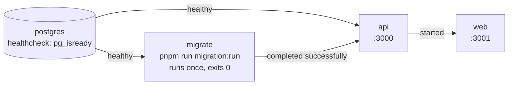

# Local development

The full local setup: what each environment file is for, how the Docker Compose stack starts, how to get data to log in with, and what to check when something goes wrong. The short version is in the [root README](../../README.md#run-locally).

## Prerequisites

| Tool | Version | Why |
| --- | --- | --- |
| Docker with Compose v2 | any current | Runs Postgres, the migration job, the API and the web app. The stack uses `depends_on` health and completion conditions, which need Compose v2. |
| Node.js | 20 | Host-side commands: seeding, tests, generating migrations. CI and both Dockerfiles use Node 20. |
| pnpm | 10.30.3 | Pinned by `packageManager` in `package.json`. `corepack enable` installs the pinned version. |

## Environment files

Two files, both gitignored, both created from [`.env.example`](../../.env.example), which documents every variable.

| File | Read by | Must contain |
| --- | --- | --- |
| `.env` (root) | `docker compose`, for `${…}` substitution in `docker-compose.yml` | `DB_USERNAME`, `DB_PASSWORD`, `DB_NAME`, `DB_PORT`. Optional: `APP_DEBUG`, `WEB_ORIGIN`, `NODE_ENV`. |
| `apps/api/.env` | The API (Nest `ConfigModule`), the TypeORM CLI and the seed script | `JWT_SECRET` (required; the API refuses to start without it), `JWT_EXPIRES_IN`, the same `DB_*` values. Optional: `ADMIN_SEED_EMAIL`, `ADMIN_SEED_PASSWORD`. |

How `apps/api/.env` reaches the container: `.dockerignore` excludes only the root `.env`, so `apps/api/.env` is copied into the API image at build time. `docker-compose.yml` then overrides `DB_HOST`/`DB_PORT` with the container-network address (`postgres:5432`), and environment variables win over the file. **Rebuild the image (`--build`) after changing `apps/api/.env`.**

On the host, `DB_HOST=localhost` and `DB_PORT` (the host-mapped port) in `apps/api/.env` are what `pnpm db:seed` and the migration commands use.

`apps/web` needs no file for local use: `NEXT_PUBLIC_API_URL` defaults to `http://localhost:3000/graphql` (see [`apps/web/.env.example`](../../apps/web/.env.example)). That URL is reached by the browser, so it is the host-mapped port, not the container network.

Never commit either `.env` file, and never put real credentials in `.env.example`.

## Start the stack

```bash
docker compose up -d --build
```



*Startup order enforced by `docker-compose.yml`. The API starts only after every pending migration has applied; if `migrate` fails, `api` and `web` never start.*

| Service | Image | Host port | Notes |
| --- | --- | --- | --- |
| `postgres` | `postgres:16-alpine` | `${DB_PORT}` | Data in the `clensy_postgres_data` volume. |
| `migrate` | `Dockerfile` | — | Applies pending migrations, then exits. |
| `api` | `Dockerfile` | 3000 | Runs as `NODE_ENV=development` unless `.env` sets `NODE_ENV=production`. |
| `web` | `Dockerfile.web` | 3001 | Production Next.js build (`next start`). |

**Ports.** 3000 and 3001 are fixed in `docker-compose.yml`, and the rest of the setup assumes them: the web app calls `http://localhost:3000/graphql` by default and the API allows CORS from `http://localhost:3001` by default. Only the Postgres host port is configurable (`DB_PORT`). If another process or Compose stack holds 3000 or 3001, `docker compose up` fails with `port is already allocated` or `address already in use`; stop that process first. Two checkouts of this repository cannot run their stacks at the same time.

The stack runs **built images**, not watch mode. After changing code, run `docker compose up -d --build` again.

## Seed data

A fresh database has the schema and one bootstrap tenant (created by a migration), but no admin account, so nobody can log in until you seed. Seeding is a separate, explicit step; it never runs on boot.

```bash
corepack enable
pnpm install
pnpm db:seed
```

`pnpm db:seed` is idempotent: every row has a fixed key and is upserted, so running it again never duplicates data. It:

1. Upserts one fixture Customer, Property, Service and Team, then three bookings that reference them.
2. If `ADMIN_SEED_EMAIL` and `ADMIN_SEED_PASSWORD` are both set in `apps/api/.env`, upserts a `TENANT_OWNER` admin of the bootstrap tenant with those credentials. If either is unset it prints `Skipping dev Owner seed` and carries on.

**Re-running resets the seed's own rows.** The fixture customer, property, service, team and bookings are overwritten with their seed values (by id), so edits made to them are lost. The admin is upserted by email, so its password is reset to `ADMIN_SEED_PASSWORD`, its role to `TENANT_OWNER` and it is re-enabled. No other row is touched.

`pnpm install` may warn about "Ignored build scripts" (bcrypt, esbuild and others). The seed and the commands in this guide work without approving them.

The bookings have the fixed ids `00000000-…-0001` to `…0003`. The seed creates no tenant and no other roles. Create further data through the web console, or through GraphQL once logged in (`createCustomer`/`createProperty`, `createCleaner`/`createTeam`, `createService`/`createAddOn`/`createPricingRule`, `createJobFromBooking`, `receiveLaundryOrder`). Seed sources: `apps/api/src/platform/database/seed.ts` (entrypoint) and `apps/api/src/modules/bookings/infrastructure/persistence/seed/`.

## Local URLs

| URL | What |
| --- | --- |
| http://localhost:3001/login | Web console sign-in (public) |
| http://localhost:3001/app | Web console, signed in. Tenant users land on their first visible nav item: Bookings, Jobs, Laundry, Billing, Customers, Cleaners, Teams, Catalog, Add-ons, Admin (Tenant Owner only). A Super Admin lands on `/app/platform`. |
| http://localhost:3000/graphql | GraphQL API (POST only; a browser visit returns 400) |
| http://localhost:3000/graphiql | GraphiQL IDE (dev only) |
| http://localhost:3000/bookings | REST bookings (requires the session cookie) |
| http://localhost:3000/docs | Swagger UI for REST (dev only) |

Which page each role sees is described in [`apps/web/README.md`](../../apps/web/README.md).

## Checking it works

```bash
docker compose ps -a
```

Expected: `postgres` running (healthy), `migrate` exited (0), `api` and `web` running.

```bash
curl -s http://localhost:3000/graphql \
  -H 'content-type: application/json' \
  -d '{"query":"{ __typename }"}'
```

Expected: `{"data":{"__typename":"Query"}}`.

Then open http://localhost:3001/login and sign in with the `ADMIN_SEED_*` credentials from `apps/api/.env`.

## Debugging

- **Logs:** `docker compose logs -f api` (or `web`, `migrate`).
- **SQL logging:** set `APP_DEBUG=true` in the root `.env`, then recreate the container with `docker compose up -d api`. Only the exact string `true` enables it.
- **Database shell:** `docker compose exec postgres psql -U <DB_USERNAME> -d <DB_NAME>`.
- **GraphQL by hand:** GraphiQL at `/graphiql`. Log in with the `login` mutation first; the session is an HttpOnly cookie (`clensy_admin_session`) the browser then sends automatically.

## Troubleshooting

| Symptom | Cause | Fix |
| --- | --- | --- |
| `api` keeps restarting; logs say `JWT_SECRET must be set` | `apps/api/.env` missing, or `JWT_SECRET` empty, when the image was built | Set `JWT_SECRET` in `apps/api/.env` (for example `openssl rand -base64 32`), then `docker compose up -d --build`. |
| `docker compose up` fails with `port is already allocated` / `address already in use` on 3000 or 3001 | Another process or Compose stack holds the port (for example a second checkout's stack) | Stop it: `docker ps`, `lsof -i :3000`. These ports are fixed; see [ports](#start-the-stack). |
| `postgres` fails to bind its port | Something else already uses `DB_PORT` (often a local Postgres on 5432) | Change `DB_PORT` in both `.env` and `apps/api/.env`. |
| `api` and `web` never start; `migrate` exited non-zero | A migration refused to run against existing data | `docker compose logs migrate`; the migration's own pre-check message names the rows. See [database migrations](../development/database-migrations.md). |
| Login fails on a fresh database | No admin exists yet | Set `ADMIN_SEED_EMAIL`/`ADMIN_SEED_PASSWORD` in `apps/api/.env` and run `pnpm db:seed`. |
| `pnpm db:seed` cannot connect | Host-side values in `apps/api/.env` do not match the stack | `DB_HOST=localhost`, `DB_PORT` = the host-mapped port, same credentials as the root `.env`. |
| Browser requests fail with CORS errors | The web app runs on a different origin than `WEB_ORIGIN` | Set `WEB_ORIGIN` in the root `.env` to the web origin and recreate `api`. |
| Code changes don't show up | The stack runs built images | `docker compose up -d --build`. |
| `/graphiql` is blank, or the `app` e2e suite fails on a fresh checkout | `apps/api/public/graphiql/` is generated and gitignored | `pnpm --filter api build:graphiql`. |
